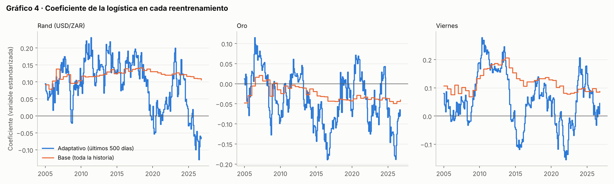

# 4. Modelo 1: dirección (sistema adaptativo)

> **Resumen.** El modelo 1 estima, para cada día, la probabilidad *p* de que mañana convenga estar comprado en dólares, es decir, que el dólar suba más que el carry. Es el promedio simple de dos componentes con las mismas 11 variables:
>
> - una red **LSTM** que mira los últimos 20 días, entrenada con toda la historia pero con **peso exponencial** (un día de hace un año pesa la mitad);
> - una **regresión logística** entrenada **solo con los últimos 500 días**.
>
> Ambos se reentrenan **cada 21 días**. La versión anterior (**sistema base**) usaba toda la historia con igual peso y se reentrenaba cada 126 días. Funcionó bien hasta 2024 y falló en 2025-2026, cuando varias relaciones se invirtieron. El adaptativo sigue esos cambios: el coeficiente del rand, por ejemplo, pasó de +0,14 a −0,07. A cambio, rinde menos cuando las relaciones son estables y calibra peor sus probabilidades.

---

## 4.1 Qué predice

| Elemento | Definición |
|---|---|
| Objetivo | `y_sube_neto`: 1 si el retorno del dólar de *t* a *t+1* supera al carry (conviene estar comprado), 0 si no (conviene estar vendido). |
| Salida | Probabilidad *p* entre 0 y 1. |
| Dirección | Comprar si *p* > 0,5; vender si *p* < 0,5. |
| Confianza | \|*p* − 0,5\|: cuánto se aleja la probabilidad del empate. La usa el modelo 2. |
| Variables | Las 11 de la sección 2.8, con datos desde 2001. |

Usamos el retorno **neto de carry** porque es lo que realmente gana una posición. La función de pérdida es la **entropía cruzada binaria** (log-loss), que premia las probabilidades bien calibradas; las bases del torneo premian explícitamente la calibración.

---

## 4.2 Los dos componentes

### Componente A · LSTM (20 días), con peso exponencial

Una red recurrente **LSTM** recibe, para cada día, la secuencia de las 11 variables de los últimos 20 días y devuelve una probabilidad.

| Elemento | Valor | Por qué |
|---|---|---|
| Arquitectura | 1 capa LSTM de 16 unidades + 1 capa lineal (~1.800 parámetros) | Con ruido alto, una red grande se sobreajusta. |
| Ventana de secuencia | 20 días hábiles (~1 mes) | Captura dinámica reciente sin pedir demasiada historia. |
| Datos de entrenamiento | Toda la historia; el día con antigüedad *a* pesa 0,5^(*a*/250) | Conserva los datos para aprender la forma de la relación y deja que lo reciente decida el ajuste. Con solo 500 días, el LSTM se degrada (sección 4.5). |
| Reajuste | Cada 21 días hábiles | Sigue los cambios de régimen al mes. |
| Regularización | Dropout 0,2; *weight decay* 10⁻³; *clipping* del gradiente en 1 | Contra el sobreajuste. |
| Optimización | Adam, tasa 10⁻³, lotes de 128, máx. 60 épocas, *early stopping* con paciencia 8 | Sección 3.4. |
| Calibración | Platt en la validación interna, ponderada | Convierte la salida en una probabilidad. |
| Semillas | 5 redes por reajuste; *p* = calibración del promedio de sus salidas | La inicialización aleatoria mueve el resultado (sección 4.5). |

### Componente B · Regresión logística, ventana de 500 días

Una logística con las mismas 11 variables del día *t* (sin secuencia), regularización L2 (C = 0,05), estimada **solo con los últimos 500 días hábiles** (unos dos años) y reestimada cada 21 días. Con 11 coeficientes, 500 días bastan para estimarla, y la ventana corta deja que los pesos cambien de signo si la relación cambia.

### Modelo 1 · Promedio

$$p = \tfrac{1}{2}\,(p_{\text{LSTM}} + p_{\text{logística}})$$

El promedio con pesos iguales no estima nada adicional y compensa en parte los errores de cada componente (Timmermann, 2006). En el adaptativo esto pesa más que en el base, porque sus componentes se parecen menos. La correlación entre las dos probabilidades es de 0,37 a 0,54 según el tramo, frente a 0,69 a 0,77 en el base después de 2015.

---

## 4.3 Por qué un modelo adaptativo

En octubre-noviembre de 2026 el sistema base operó 5 días y falló los 5 (−9,8%). El diagnóstico mostró que las relaciones que el modelo explotaba se habían debilitado desde 2024 y se habían **invertido** en 2025-2026:

| Relación (base desde 2010) | 2010-2019 | 2022-2024 | 2025-2026 |
|---|---|---|---|
| Correlación del rand en *t* con el peso en *t+1* (cierre asincrónico) | +0,157 | +0,020 | −0,045 |
| Autocorrelación del USD/CLP de *t* a *t+1* | +0,07 | +0,04 | −0,15 |
| Viernes → lunes, retorno medio | +4,8 pb (2015-21) | +16,6 pb | −2,6 pb |

En 2025-2026 el peso incorpora el movimiento global el mismo día (correlación con el rand del mismo día: 0,66) y los movimientos grandes tienden a revertir al día siguiente. Una logística entrenada con toda la historia desde 2001 sigue ponderando esas relaciones como en 2010-2019. Así se ven los coeficientes en cada reentrenamiento:

| Coeficiente de la logística (promedio del año) | 2012 | 2018 | 2022 | 2024 | 2025 | 2026 |
|---|---|---|---|---|---|---|
| Rand · adaptativo | +0,142 | +0,135 | +0,066 | +0,070 | **−0,035** | **−0,074** |
| Rand · base | +0,119 | +0,137 | +0,122 | +0,119 | +0,113 | +0,108 |
| Oro · adaptativo | +0,020 | −0,019 | −0,087 | −0,007 | −0,122 | −0,105 |
| Oro · base | −0,008 | −0,039 | −0,036 | −0,036 | −0,047 | −0,042 |

El base mantiene el coeficiente del rand en ~+0,11 aunque la relación ya se invirtió. El adaptativo lo lleva a terreno negativo en 2025.

---

## 4.4 Calidad de las probabilidades

Dos medidas:

- **Mejora de log-loss:** si la probabilidad es mejor que la frecuencia base de entrenamiento (×1000; positivo es mejor).
- **Acierto en el quintil superior (Q5):** si los días de mayor confianza aciertan más.

| Modelo | Log-loss · p1 2005-14 | p2 2015-21 | Validación | Test 2025-26 | Acierto Q5 · p1 | p2 | Validación | Test |
|---|---|---|---|---|---|---|---|---|
| **Adaptativo (promedio)** | +0,94 | −0,07 | +1,61 | −6,32 | 55,1% | 54,1% | 56,4% | 47,7% |
| Componente: LSTM exponencial | −1,51 | −0,15 | +1,55 | −2,80 | 52,6% | 56,1% | 53,0% | 55,7% |
| Componente: logística 500 días | −2,11 | −3,65 | −0,89 | −13,13 | 56,3% | 53,5% | 55,0% | 50,0% |
| *Control: sistema base (promedio)* | +1,68 | +1,88 | +3,80 | −4,51 | 53,8% | 56,1% | 60,4% | 44,3% |

Calculado sobre los días en que opera el sistema completo (desde febrero de 2006).

**Lectura:**

- **El adaptativo calibra peor.** La logística con 500 días es más ruidosa: sus probabilidades no superan a la frecuencia base en ningún tramo, y en el test quedan claramente por debajo (−13,1). Es el costo de adaptarse rápido. Solo esa diferencia del test es significativa (t de Diebold-Mariano −2,09); en el resto de las celdas, |t| < 1,7.
- **En el test, nadie calibra.** También el base pierde contra la frecuencia base (−4,5). El cambio de régimen afectó a todos los modelos.
- **El LSTM exponencial es el componente más estable.** Es el único que mantiene acierto en Q5 sobre 52% en los cuatro tramos (55,7% en el test).
- **El base ordenaba mejor en 2015-2024 y peor fuera de ese periodo.** Su acierto en Q5 cae a 44,3% en el test.

---

## 4.5 Cómo llegamos al modelo adaptativo

Lo dejamos explícito porque es la principal limitación de este informe.

**Paso 1 · El sistema base (hasta noviembre de 2026).** Promedio de LSTM y logística con toda la historia, reentrenado cada 126 días, elegido con las reglas del protocolo. El LSTM se reincorporó tras fallar una regla previa, por su retorno en los días de mayor confianza, y el promedio se prefirió por diversificación. Ganaba +284% en 2015-2021 y +108% en validación.

**Paso 2 · La falla.** En el test 2025-2026 perdió −18,5%, y con los datos reales de octubre-noviembre, −9,8% (sección 6).

**Paso 3 · Variantes del modelo 1, con un diseño fijado antes de correrlas** (logística sola, 11 variables, mismo modelo 2):

| Variante | Desarrollo 2015-21 | Validación | Test 2025-26 |
|---|---|---|---|
| Logística con toda la historia (base) | +209,9% | +101,1% | −9,1% |
| Pesos por correlación móvil de 21 / 63 / 126 / 250 días | −49% a +130% | −18% a +29% | −52% a −14% |
| Logística con ventana de 250 días | +87,7% | +33,3% | +5,0% |
| **Logística con ventana de 500 días** | +150,9% | **+116,7%** | **+2,7%** |
| Logística + retorno propio del peso (reversión) | +192,6% | +98,4% | −9,9% |

Con la regla del protocolo (elegir en desarrollo) seguía ganando la base. La ventana de 500 días fue la única variante que mejoró en validación y sobrevivió al test.

**Paso 4 · Sistema completo.** Se probaron combinaciones del LSTM y la logística (mismo modelo 2):

| Combinación | Desarrollo 2015-21 | Validación | Test 2025-26 | Oct-nov 2026 |
|---|---|---|---|---|
| Base (sistema anterior) | +284,3% | +107,7% | −18,5% | −9,8% |
| **LSTM exponencial + logística 500 días (adaptativo)** | +137,4% | +63,7% | **+13,4%** | **−1,0%** |
| LSTM exponencial solo | +197,6% | +87,9% | +19,9% | −6,2% |
| Logística 500 días sola | +150,9% | +116,7% | +2,7% | +0,3% |
| LSTM con ventana de 500 días solo | +60,8% | −5,7% | −18,9% | −2,5% |
| LSTM exponencial + logística con toda la historia | +190,3% | +38,9% | +12,1% | −5,9% |

**Paso 5 · Decisión.** Adoptamos el promedio de LSTM exponencial y logística de 500 días como sistema oficial, con todos los parámetros congelados desde el 9 de noviembre de 2026. Las razones:

1. **Es una protección contra cambios de régimen, que es justo lo que pasó.** Todas las versiones adaptativas ganan en 2025-2026 y pierden contra el base en 2015-2024. Su costo en periodos estables es real.
2. **La evidencia limpia lo favorece.** En 2005-2014, que no participó en ninguna elección, el adaptativo gana +205% contra +86% del base (sección 6).
3. **Combina los dos componentes más robustos al cambio** y mantiene la arquitectura de dos componentes del base. No es el que más ganó en el test: el LSTM exponencial solo ganó más, pero ese componente cayó a +46,6% en 2005-2014.

**Advertencias:**

- **La elección se hizo después de ver el test.** Con la regla original habría ganado el base.
- **Las semillas importan.** Con otro juego de semillas del LSTM (desplazadas en 7), el Sharpe del adaptativo pasa de 0,79 a 0,95 en desarrollo, de 0,80 a 0,61 en validación y de 0,56 a 0,55 entre enero de 2025 y agosto de 2026. Las conclusiones no cambian, pero cada cifra individual tiene un margen de ese orden.

---

## 4.6 Versiones descartadas

| Versión | Por qué se descartó |
|---|---|
| Sistema base (toda la historia, cada 126 días) | No se descartó: es el control de las secciones 6 y 7. |
| Versión “completa” (15 variables, desde 2010) | Menos historia; el LSTM empeora la log-loss en validación. |
| LSTM de 1 día | Control para medir si la secuencia aporta: bien calibrado, sin ventaja al operar. |
| LSTM con ventana de 500 días | Le faltan datos: −5,7% en validación. |
| Pesos por correlación móvil | Con 21 a 126 días, el error de una correlación (±0,22 con 21 días) supera a las correlaciones reales (0,05-0,15). |
| IPSA como variable adicional | Mejora el promedio en desarrollo y validación sin significancia (t ≈ 1,4-1,5) y no en el test. Sección 8. |
| Otros modelos (Taylor, XGBoost, aprendizaje por refuerzo, técnicos y otros) | Sección 8. |

### Referencias

- Hochreiter, S. y Schmidhuber, J. (1997). Long short-term memory. *Neural Computation*, 9(8), 1735-1780.
- Pesaran, M. H. y Timmermann, A. (2007). Selection of estimation window in the presence of breaks. *Journal of Econometrics*, 137(1), 134-161.
- Platt, J. (1999). Probabilistic outputs for support vector machines and comparisons to regularized likelihood methods. *Advances in Large Margin Classifiers*, 61-74.
- Timmermann, A. (2006). Forecast combinations. En *Handbook of Economic Forecasting*, vol. 1, 135-196. Elsevier.
