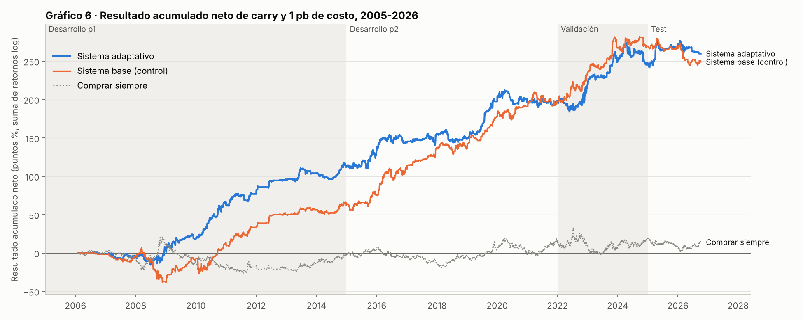

# 6. Resultados fuera de muestra y significancia

> **Resumen.** Evaluamos el sistema completo, neto de carry y de costos, en cuatro tramos fuera de muestra y con 22 días de datos reales:
>
> - **sistema adaptativo** (oficial): LSTM exponencial + logística de 500 días → confianza → GARCH;
> - **sistema base** (control): la versión anterior, que usa toda la historia con igual peso.
>
> El adaptativo gana en los cuatro tramos y le gana al base en dos:
>
> | Tramo | Adaptativo | Base |
> |---|---|---|
> | 2005-2014 | +205% | +86% |
> | Test 2025-2026 | +13% | −19% |
>
> Pierde contra el base en 2015-2021 y en validación. Sumando 2006-2026, los dos rinden casi lo mismo. En 2005-2014 el adaptativo supera a las tres referencias del torneo con significancia. En validación y en el test solo supera a operar siempre ±1.
>
> Hay tres advertencias:
>
> 1. El adaptativo se eligió después de ver el test.
> 2. Su resultado en el test depende de unos pocos días.
> 3. Corregido por las ~349 configuraciones probadas, solo 2005-2014 es concluyente.

---

## 6.1 Qué evaluamos y cómo

| Elemento | Definición |
|---|---|
| Sistema | Modelo 1 adaptativo (sección 4) → modelo 2 (confianza + tope GARCH 1,5, sección 5). |
| Control | Sistema base: el mismo modelo 2 sobre el modelo 1 con toda la historia, reentrenado cada 126 días. |
| Resultado diario | exposición × retorno neto de carry − costo × \|cambio de exposición\| |
| Costos | 0, 1, 2 y 5 pb por unidad de cambio de exposición. La cifra principal usa 1 pb. [confirmar: costo del laboratorio] |
| Referencias (bases) | **Comprar siempre** (+1 todos los días), **no operar nunca** (0) y **operar siempre con exposición 1** en la dirección del modelo (±1). |
| Tramos | Desarrollo parte 1 (2005-2014; el sistema opera desde febrero de 2006), desarrollo parte 2 (2015-2021), validación (2022-2024), test (2025-01 a 2026-10-05) y datos reales (6-oct a 5-nov-2026). |

Todas las cifras son fuera de muestra respecto del modelo 1: cada día se predice con un modelo entrenado solo con datos anteriores. Cada tramo tiene un estatus distinto respecto de las elecciones (sección 3.5):

| Tramo | Estatus |
|---|---|
| 2005-2014 | No participó en ninguna elección. Es la comparación más limpia. |
| 2015-2021 | Se eligieron las variables y el modelo 2. |
| Validación y test | Se usaron para elegir el adaptativo. |

> [completar: resultado en el tramo de test con el código de evaluación del laboratorio]

---

## 6.2 Resultado económico

### Por tramo, con 1 pb de costo

| Estrategia | Desarrollo p1 2005-14 | Desarrollo p2 2015-21 | Validación 2022-24 | Test 2025-26 |
|---|---|---|---|---|
| **Sistema adaptativo** | **+205,2%** (Sharpe 1,12) | +137,4% (0,79) | +63,7% (0,80) | **+13,4%** (0,47) |
| *Control: sistema base* | +85,5% (0,58) | +284,3% (1,17) | +107,7% (1,16) | −18,5% (−0,81) |
| *Control: LSTM exponencial solo* | +46,6% (0,37) | +197,6% (0,97) | +87,9% (1,12) | +19,9% (0,74) |
| *Control: logística 500 días sola* | +235,6% (1,15) | +150,9% (0,83) | +116,7% (1,13) | +2,7% (0,09) |
| Comprar siempre | −2,9% | +20,5% | +3,0% | −4,4% |
| Operar siempre ±1 (dirección del adaptativo) | +62,2% | +63,9% | −8,7% | −23,1% |
| Operar siempre ±1 (dirección del base) | +6,5% | +101,4% | +11,4% | −10,0% |
| No operar nunca | 0% | 0% | 0% | 0% |

El gráfico muestra dos estrategias que llegan a un nivel parecido por caminos distintos. El adaptativo gana sobre todo en 2008-2010 y en 2025. El base gana en 2015-2024, cuando el cierre asincrónico todavía transmitía información y las relaciones eran estables.

### Sensibilidad a los costos (sistema adaptativo)

| Tramo | 0 pb | 1 pb | 2 pb | 5 pb | Costo de equilibrio |
|---|---|---|---|---|---|
| Desarrollo p1 | +271,0% | +205,2% | +151,1% | +39,8% | 6,7 pb |
| Desarrollo p2 | +188,4% | +137,4% | +95,4% | +9,0% | 5,4 pb |
| Validación | +77,2% | +63,7% | +51,2% | +19,3% | 7,2 pb |
| Test | +18,3% | +13,4% | +8,6% | −4,4% | 3,9 pb |

El costo de equilibrio es el costo por unidad de rotación que dejaría el resultado en cero. Al reentrenarse cada 21 días, el adaptativo cambia de posición algo más que el base: su costo de equilibrio en validación es 7,2 pb, frente a 9,6 pb del base.

### Riesgo y uso de la exposición (1 pb)

| Estrategia | Tramo | Máxima caída | Peor mes | % días fuera (0) | % días en ±1 | % días en ±3 |
|---|---|---|---|---|---|---|
| Adaptativo | Desarrollo p1 | −15,8% | −7,1% | 62% | 23% | 15% |
| Adaptativo | Desarrollo p2 | −19,8% | −9,3% | 59% | 21% | 20% |
| Adaptativo | Validación | −24,6% | −12,5% | 58% | 23% | 19% |
| Adaptativo | Test | −15,4% | −10,1% | 65% | 21% | 15% |
| Base | Desarrollo p1 | −35,9% | −11,2% | 63% | 22% | 15% |
| Base | Validación | −18,6% | −13,3% | 58% | 23% | 19% |
| Base | Test | −29,6% | −9,5% | 62% | 21% | 17% |

### Por año (1 pb)

| Año | Adaptativo | Base | | Año | Adaptativo | Base |
|---|---|---|---|---|---|---|
| 2006 | −0,6% | −1,9% | | 2017 | +12,1% | +32,6% |
| 2007 | −2,9% | −2,2% | | 2018 | −6,5% | −1,1% |
| 2008 | +11,0% | −28,7% | | 2019 | +63,0% | +51,3% |
| 2009 | +11,8% | +34,9% | | 2020 | −1,2% | +13,9% |
| 2010 | +62,3% | +24,6% | | 2021 | +1,8% | +5,9% |
| 2011 | +11,1% | +21,2% | | 2022 | +23,5% | +45,8% |
| 2012 | +20,8% | +18,4% | | 2023 | +35,4% | +39,2% |
| 2013 | +8,2% | +6,0% | | 2024 | −2,0% | +2,4% |
| 2014 | +8,1% | +5,9% | | **2025** | **+24,2%** | **−2,9%** |
| 2015 | +26,2% | +14,2% | | **2026** (a oct.) | **−8,7%** | **−16,1%** |
| 2016 | +9,5% | +40,5% | | | | |

Dos lecturas:

1. **El adaptativo también pierde en 2026** (−8,7%), aunque menos que el base. La adaptación no evita las pérdidas cuando el régimen sigue cambiando; las reduce.
2. **2008 muestra la otra cara de la adaptación.** El base perdió −28,7% y el adaptativo ganó +11,0%. Los pesos aprendidos en 2001-2007 no servían en la crisis, y los recientes sí.

---

## 6.3 Adaptativo contra base

Diferencia diaria de resultado (adaptativo − base), con 1 pb. P es la probabilidad de bootstrap (bloques de 20 días) de que el adaptativo no sea mejor.

| Tramo | Diferencia media (pb/día) | P | Correlación diaria entre ambos |
|---|---|---|---|
| Desarrollo p1 | +2,5 | 0,081 | 0,55 |
| Desarrollo p2 | −2,8 | 0,883 | 0,54 |
| Validación | −3,2 | 0,751 | 0,61 |
| Test | +7,5 | 0,057 | 0,35 |
| **2006-2026 completo** | **+0,2** | **0,446** | 0,55 |

En el conjunto, **ninguno domina al otro**. El adaptativo es mejor en los periodos de cambio (2008-2010, 2025) y peor en los estables (2016-2017, 2020-2023). Cuando ambos operan el mismo día, coinciden en la dirección el 96-98% de las veces. La diferencia está en **qué días operan y con qué tamaño**.

---

## 6.4 Significancia estadística

Las bases piden dos pruebas: **Diebold-Mariano** para la calidad de la predicción y **bootstrap no paramétrico** para el resultado económico. Agregamos un placebo y el Sharpe deflactado.

### Calidad de la predicción: Diebold-Mariano sobre log-loss

La tabla de la sección 4.4 reporta la mejora de log-loss frente a la frecuencia base. **Ninguna mejora es significativa en ningún tramo, ni para el adaptativo ni para el base.** En el test, ambos quedan por debajo de la frecuencia base. El acierto de dirección, contando todos los días, ronda 51% en 2005-2024 y cae a 46% en el test para el adaptativo (51% para el base).

### Resultado económico (1 pb): bootstrap por bloques y Diebold-Mariano

p unilateral de que la estrategia **no** sea mejor que la referencia (bootstrap de bloques de 20 días sobre la diferencia diaria; entre paréntesis, Diebold-Mariano con Newey-West). En negrita, p < 0,05.

| Estrategia | Tramo | vs ±1 siempre | vs comprar siempre | vs no operar |
|---|---|---|---|---|
| **Adaptativo** | Desarrollo p1 | **0,026** (0,021) | **0,015** (0,018) | **0,001** (0,001) |
| **Adaptativo** | Desarrollo p2 | 0,151 (0,142) | 0,076 (0,076) | **0,024** (0,021) |
| **Adaptativo** | Validación | **0,028** (0,031) | 0,188 (0,189) | 0,089 (0,103) |
| **Adaptativo** | Test | **0,013** (0,024) | 0,237 (0,269) | 0,281 (0,294) |
| *Base* | Desarrollo p1 | **0,043** (0,045) | 0,137 (0,156) | 0,053 (0,058) |
| *Base* | Desarrollo p2 | **0,029** (0,029) | **0,013** (0,013) | **0,002** (0,001) |
| *Base* | Validación | **0,013** (0,023) | 0,096 (0,092) | **0,030** (0,029) |
| *Base* | Test | 0,682 (0,693) | 0,678 (0,725) | 0,826 (0,855) |

- **En 2005-2014, el adaptativo supera a las tres referencias al 5%.** Es su resultado más sólido, y en un tramo que no participó en ninguna elección.
- **En validación y en el test solo supera a operar siempre ±1.** Frente a comprar siempre y a no operar, la diferencia no es significativa.
- **El base, en el test, no supera a ninguna referencia.** Pierde contra todas.

### Placebo de dirección

Sorteamos 2.000 veces una dirección al azar, manteniendo exactamente la exposición diaria de la estrategia (mismos días operados y mismos tamaños). Se reporta el % de sorteos que gana más que la estrategia real.

| Estrategia | Desarrollo p1 | Desarrollo p2 | Validación | Test |
|---|---|---|---|---|
| Adaptativo | 0,0% | 0,5% | 5,3% | 19,8% |
| Base | 1,8% | 0,0% | 1,4% | 77,9% |

La dirección del adaptativo es claramente mejor que el azar hasta 2021. En validación queda en el límite y en el test no se distingue del azar (19,8%). Su ventaja en el test viene más de **cuándo** opera y con qué tamaño que de acertar la dirección.

### Sharpe deflactado

El Sharpe deflactado (Bailey y López de Prado, 2014) corrige por haber elegido la mejor entre muchas configuraciones. Con las **~349 configuraciones** del proyecto, el umbral es el Sharpe que una estrategia sin señal alcanzaría por azar en un tramo de ese largo.

| Estrategia | Tramo | Sharpe | Umbral por azar | P(Sharpe verdadero > 0) |
|---|---|---|---|---|
| Adaptativo | Desarrollo p1 (9 años) | 1,12 | 1,04 | **0,60** |
| Adaptativo | Desarrollo p2 (7 años) | 0,79 | 1,13 | 0,19 |
| Adaptativo | Validación (3 años) | 0,80 | 1,71 | 0,06 |
| Adaptativo | Test (1,8 años) | 0,47 | 2,23 | 0,01 |
| Base | Validación (3 años) | 1,16 | 1,71 | 0,17 |

Corregido por el número de pruebas, **solo 2005-2014 sostiene que el Sharpe del adaptativo sea positivo**. En tramos cortos el umbral sube tanto que ninguna estrategia razonable lo alcanza. El test, en particular, es demasiado corto para concluir algo por sí solo.

---

## 6.5 De dónde viene el resultado

| Diagnóstico (1 pb) | Desarrollo p1 | Desarrollo p2 | Validación | Test |
|---|---|---|---|---|
| Resultado total del adaptativo | +11.160 pb | +8.644 pb | +4.930 pb | +1.255 pb |
| Sin los 10 mejores días | +5.767 pb | +3.067 pb | +27 pb | **−2.946 pb** |
| Parte ganada en el gap nocturno (cierre *t* → apertura *t+1*) | 81% | 58% | 39% | 46% |
| *Base: parte ganada en el gap* | 84% | 77% | 60% | (resultado negativo) |

Tres lecturas:

1. **El resultado depende de pocos días.** Sin los 10 mejores días, el adaptativo queda en cero en validación y pierde 25% en el test. Esos 10 días son, en todos los tramos, de exposición 3 (sección 7).
2. **El adaptativo depende menos del cierre asincrónico.** En validación y en el test, menos de la mitad de su ganancia se genera en la apertura del día siguiente, contra 60-84% del base. Es coherente con que sus pesos ya no apuestan a que el peso “alcance” al rand al día siguiente.
3. **Su ventaja no es acertar más, sino perder menos en los días equivocados.** En el test, el adaptativo acierta el 50,3% de los días que opera y el base el 48,5%. La diferencia de resultado viene del tamaño: los ±3 del adaptativo ganaron y los del base perdieron (sección 7).

---

## 6.6 Datos reales: octubre-noviembre de 2026

Con la base actualizada que entregó el laboratorio (días nuevos hasta el 6 de noviembre), simulamos la operación en vivo día por día: para cada fecha, la base se corta en ese día y se calcula la señal con el mismo código del monitoreo. Son 22 decisiones, del 6 de octubre al 5 de noviembre.

| Estrategia | Resultado |
|---|---|
| **Sistema adaptativo** | **−1,0%** |
| Sistema base | −9,8% (5 días operados, los 5 fallidos) |
| Comprar siempre | +0,4% |
| No operar | 0% |

Con 22 días, ninguna diferencia es distinguible del azar. Estos días motivaron la revisión del modelo 1 (sección 4.5), así que tampoco son una evaluación independiente del adaptativo.

---

## 6.7 Conclusión

- **El adaptativo cambia rentabilidad en periodos estables por protección en periodos de cambio.** Gana en los cuatro tramos y le gana al base en 2005-2014 y en 2025-2026, pero pierde contra él en 2015-2024. En el conjunto de 2006-2026, ninguno domina.
- **La evidencia más limpia a su favor es 2005-2014.** Es el único tramo en que supera a las tres referencias del torneo y pasa el Sharpe deflactado, y no se usó en ninguna elección.
- **Su ventaja en el test no es concluyente.** Se eligió mirando ese tramo, depende de pocos días y su dirección no supera al azar ahí.
- **La única evaluación limpia es el monitoreo en vivo.** Esperamos un desempeño modesto: el entorno de 2025-2026 es peor para estas señales que el de 2005-2024.

Las limitaciones y la operación en vivo se discuten en la sección 9.

### Referencias

- Bailey, D. y López de Prado, M. (2014). The deflated Sharpe ratio. *Journal of Portfolio Management*, 40(5), 94-107.
- Diebold, F. y Mariano, R. (1995). Comparing predictive accuracy. *Journal of Business & Economic Statistics*, 13(3), 253-263.
- Künsch, H. (1989). The jackknife and the bootstrap for general stationary observations. *Annals of Statistics*, 17(3), 1217-1241.
- Newey, W. y West, K. (1987). A simple, positive semi-definite, heteroskedasticity and autocorrelation consistent covariance matrix. *Econometrica*, 55(3), 703-708.
