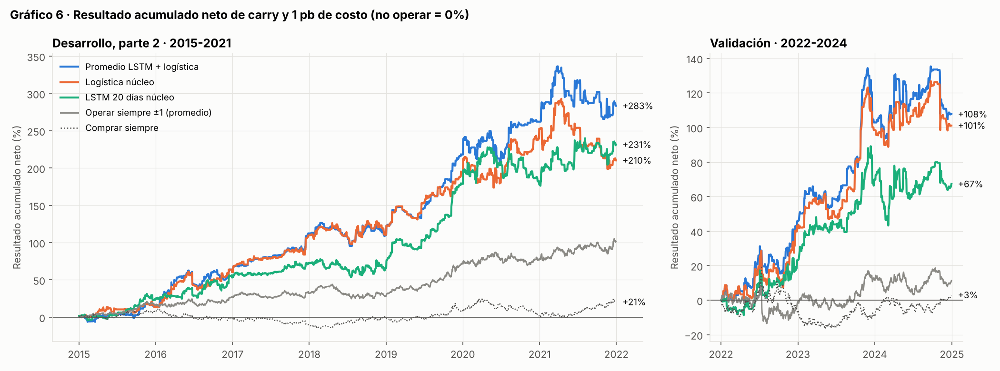

# 6. Resultados fuera de muestra y significancia

> **Resumen.** Evaluamos el sistema completo (modelo 1 + modelo 2) con sus tres señales, neto de carry y de costos, en tres tramos fuera de muestra: las dos partes del desarrollo y la validación. En **validación (2022-2024)** las tres señales superan a las referencias del torneo. El promedio LSTM + logística gana +107,7% con 1 pb de costo, frente a +3,0% de comprar siempre, y la diferencia es significativa al 5% contra operar siempre ±1 y contra no operar. El resultado se sostiene en la parte del desarrollo que no participó en ninguna elección (2005-2014). Hay tres advertencias: más de la mitad de la ganancia proviene del cierre asincrónico; 2024 ya fue prácticamente cero; y, al corregir por las ~310 configuraciones probadas, el resultado no es concluyente.

---

## 6.1 Qué evaluamos y cómo

| Elemento | Definición |
|---|---|
| Sistema | Modelo 1 (sección 4) → modelo 2 (sección 5). Tres señales: promedio LSTM + logística, logística, LSTM. Para las tres, el GARCH elegido en desarrollo fue el mismo: tope 1,5 (un 3 baja a 1 si la volatilidad relativa supera 1,5). |
| Resultado diario | exposición × retorno neto de carry − costo × \|cambio de exposición\| |
| Costos | 0, 1, 2 y 5 pb por unidad de cambio de exposición. La cifra principal usa 1 pb. [confirmar: costo del laboratorio] |
| Referencias (bases) | **Comprar siempre** (+1 todos los días), **no operar nunca** (0) y **operar siempre con exposición 1** en la dirección de la señal (±1). |
| Tramos | Desarrollo parte 1 (2005-2014, sin elecciones), desarrollo parte 2 (2015-2021, donde se eligió) y validación (2022-2024). |

Todas las cifras son fuera de muestra respecto del modelo 1: cada día se predice con un modelo entrenado solo con datos anteriores (sección 3.3). La parte 2 del desarrollo, en cambio, es dentro de muestra respecto de las elecciones (variables, umbrales y GARCH), así que su resultado está inflado por construcción. La parte 1 y la validación son las comparaciones más limpias.

> [completar: resultado en el tramo de test 2025-2026 con el código de evaluación del laboratorio]

---

## 6.2 Resultado económico

### Por tramo, con 1 pb de costo

| Señal | Desarrollo p1 2005-14 | Desarrollo p2 2015-21 | **Validación 2022-24** |
|---|---|---|---|
| Promedio LSTM + logística | +82,4% (Sharpe 0,56) | +283,4% (1,17) | **+107,7% (1,16)** |
| Logística | +126,0% (0,76) | +210,3% (0,99) | **+101,1% (1,15)** |
| LSTM 20 días | +22,5% (0,22) | +231,4% (1,08) | **+67,3% (0,82)** |
| *Comprar siempre* | −2,9% | +20,5% | +3,0% |
| *Operar siempre ±1 (promedio)* | +6,4% | +101,4% | +11,4% |
| *No operar nunca* | 0% | 0% | 0% |

### Sensibilidad a los costos (validación)

| Señal | 0 pb | 1 pb | 2 pb | 5 pb | Costo de equilibrio |
|---|---|---|---|---|---|
| Promedio | +126,3% | +107,7% | +90,7% | +47,6% | 9,6 pb |
| Logística | +120,3% | +101,1% | +83,6% | +39,8% | 8,7 pb |
| LSTM | +79,6% | +67,3% | +55,8% | +25,9% | 8,2 pb |

El costo de equilibrio es el costo por unidad de rotación que dejaría el resultado en cero. Las tres señales soportan costos varias veces mayores que el supuesto de 1 pb.

### Riesgo y uso de la exposición (validación, 1 pb)

| Señal | Máxima caída | Peor mes | % días fuera (0) | % días en ±1 | % días en ±3 |
|---|---|---|---|---|---|
| Promedio | −18,6% | −13,3% | 58% | 23% | 19% |
| Logística | −16,4% | −11,1% | 59% | 23% | 18% |
| LSTM | −24,3% | −11,1% | 38% | 43% | 19% |
| *Comprar siempre* | −29,7% | — | 0% | 100% | 0% |

### Por año (1 pb)

| Año | Promedio | Logística | LSTM |
|---|---|---|---|
| 2015 | +14,2% | +13,8% | +24,8% |
| 2016 | +40,5% | +41,0% | +22,7% |
| 2017 | +32,3% | +30,6% | +12,5% |
| 2018 | −1,1% | +0,4% | −4,0% |
| 2019 | +51,3% | +40,2% | +68,4% |
| 2020 | +13,9% | +19,5% | −0,3% |
| 2021 | +5,9% | −12,1% | +19,2% |
| 2022 | +45,8% | +43,1% | +23,2% |
| 2023 | +39,2% | +38,6% | +37,8% |
| **2024** | **+2,4%** | **+1,4%** | **−1,5%** |

La ganancia de validación se concentra en 2022-2023. En **2024 las tres señales quedan cerca de cero**, el mismo año en que el cierre asincrónico deja de transmitir información (sección 2.4).

---

## 6.3 Significancia estadística

Las bases piden dos pruebas: **Diebold-Mariano** para la calidad de la predicción y **bootstrap no paramétrico** para el resultado económico. Agregamos un placebo y el Sharpe deflactado.

### Calidad de la predicción (modelo 1): Diebold-Mariano sobre log-loss

Mejora de log-loss ×1000 frente a la frecuencia base de entrenamiento; entre paréntesis, t de Newey-West de la diferencia diaria de pérdidas.

| Señal | Desarrollo p1 | Desarrollo p2 | Validación |
|---|---|---|---|
| Promedio | +1,68 (t 1,14) | +1,88 (t 1,01) | +3,80 (t 1,67) |
| Logística | +0,75 (t 0,38) | +1,48 (t 0,68) | +5,29 (t 1,75) |
| LSTM | −0,13 (t −0,07) | +0,73 (t 0,36) | +1,42 (t 0,75) |

Las probabilidades del promedio y de la logística mejoran a la frecuencia base en los tres tramos, pero la mejora es pequeña y no alcanza significancia al 5% (t < 1,96). El acierto de dirección ronda 51-53%.

### Resultado económico (1 pb): bootstrap por bloques y Diebold-Mariano

p unilateral de que la estrategia **no** sea mejor que la referencia (bootstrap de bloques de 20 días sobre la diferencia diaria; entre paréntesis, Diebold-Mariano con Newey-West). En negrita, p < 0,05.

| Señal | Tramo | vs ±1 siempre | vs comprar siempre | vs no operar |
|---|---|---|---|---|
| Promedio | Desarrollo p1 | **0,049** (0,050) | 0,142 (0,163) | 0,060 (0,064) |
| Promedio | Validación | **0,013** (0,023) | 0,096 (0,092) | **0,030** (0,029) |
| Logística | Desarrollo p1 | 0,086 (0,107) | 0,073 (0,079) | **0,019** (0,016) |
| Logística | Validación | **0,014** (0,016) | 0,092 (0,087) | **0,042** (0,033) |
| LSTM | Desarrollo p1 | 0,427 (0,417) | 0,337 (0,353) | 0,281 (0,291) |
| LSTM | Validación | **0,022** (0,037) | 0,165 (0,170) | 0,073 (0,083) |

En validación, las tres señales superan a operar siempre ±1 al 5%, y el promedio y la logística también superan a no operar. **Ninguna supera a comprar siempre al 5%** (p ≈ 0,09-0,17). En la parte 1 del desarrollo, que no se usó para elegir, el promedio y la logística mantienen resultados cercanos a la significancia; el LSTM no.

### Placebo de dirección

Sorteamos 2.000 veces una dirección al azar, manteniendo exactamente la exposición diaria de la estrategia (mismos días operados y mismos tamaños). Se reporta el % de sorteos que gana más que la estrategia real.

| Señal | Desarrollo p1 | Desarrollo p2 | Validación |
|---|---|---|---|
| Promedio | 2,3% | 0,0% | 1,6% |
| Logística | 0,3% | 0,1% | 1,0% |
| LSTM | 18,2% | 0,0% | 6,1% |

Con el promedio y la logística, la dirección que elige el modelo es claramente mejor que el azar en los tres tramos. El LSTM solo lo es en el tramo donde se eligió.

### Sharpe deflactado

El Sharpe deflactado (Bailey y López de Prado, 2014) corrige por haber elegido la mejor entre muchas configuraciones. Con las **~310 configuraciones** registradas en el proyecto, una estrategia sin señal alcanzaría solo por azar un Sharpe de 1,69 en tres años de validación.

| Señal | Sharpe validación | P(Sharpe verdadero > 0) |
|---|---|---|
| Promedio | 1,16 | 0,18 |
| Logística | 1,15 | 0,18 |
| LSTM | 0,82 | 0,07 |

Corregido por el número de pruebas, **el resultado de validación no es suficientemente alto para descartar que sea el mejor de muchos intentos sin señal**. Las pruebas individuales (bootstrap y placebo) son favorables, pero no consideran cuántas configuraciones se probaron antes de llegar a esta.

---

## 6.4 De dónde viene el resultado

| Diagnóstico (validación, 1 pb) | Promedio | Logística | LSTM |
|---|---|---|---|
| Parte del resultado ganada en el gap nocturno (cierre *t* → apertura *t+1*) | 60% | 55% | 69% |
| Resultado total | +7.311 pb | +6.987 pb | +5.146 pb |
| Resultado sin los 10 mejores días | +1.688 pb | +1.520 pb | −3 pb |

Tres lecturas:

1. **Más de la mitad de la ganancia se genera en la apertura del día siguiente**, la huella del cierre asincrónico (sección 2.4). Es legal según las reglas, pero ese canal casi desapareció desde 2024.
2. **El resultado depende de pocos días.** Sin los 10 mejores días de validación, el promedio y la logística conservan cerca de una cuarta parte de la ganancia, y el LSTM queda en cero.
3. **Toda la ganancia viene de los días con exposición 3.** La sección 7 lo detalla.

---

## 6.5 Control: versión estricta

La versión estricta (variables que cierran después de Santiago, rezagadas un día) muestra qué parte del resultado no depende del cierre asincrónico. Según la auditoría del sistema, en validación con 1 pb el promedio gana +7,3% y la logística +17,1%, ambos sin significancia contra ninguna referencia (Diebold-Mariano, p ≥ 0,30). Sin ese canal, el sistema prácticamente no tiene señal.

---

## 6.6 Conclusión

- **El sistema supera a las referencias del torneo fuera de muestra**, de forma consistente entre tramos, incluida la parte del desarrollo que no participó en ninguna elección. El promedio y la logística son las señales más robustas; el LSTM solo, la más débil.
- **La evidencia no es concluyente** una vez que se corrige por las ~310 configuraciones probadas, y no supera a comprar siempre con significancia.
- **El resultado depende de un canal que se debilitó**: más de la mitad viene del cierre asincrónico, y 2024 ya fue prácticamente cero. Esperamos un desempeño menor en el tramo final y en el monitoreo en vivo que el de 2022-2023.
- **Lo que el sistema hace bien es abstenerse:** opera solo en el 40% (promedio y logística) a 60% (LSTM) de días de mayor confianza y concentra el tamaño en ellos.

Las implicancias para la operación en vivo y las limitaciones se discuten en la sección 9.

### Referencias

- Bailey, D. y López de Prado, M. (2014). The deflated Sharpe ratio. *Journal of Portfolio Management*, 40(5), 94-107.
- Diebold, F. y Mariano, R. (1995). Comparing predictive accuracy. *Journal of Business & Economic Statistics*, 13(3), 253-263.
- Künsch, H. (1989). The jackknife and the bootstrap for general stationary observations. *Annals of Statistics*, 17(3), 1217-1241.
- Newey, W. y West, K. (1987). A simple, positive semi-definite, heteroskedasticity and autocorrelation consistent covariance matrix. *Econometrica*, 55(3), 703-708.
